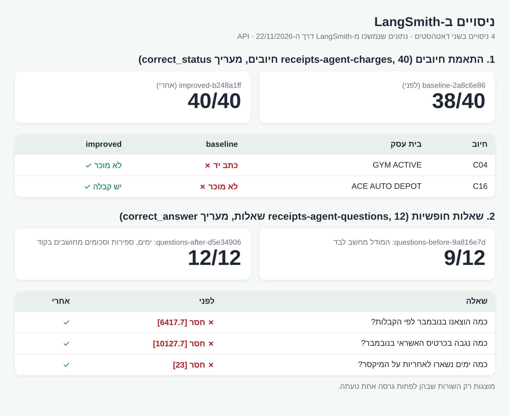
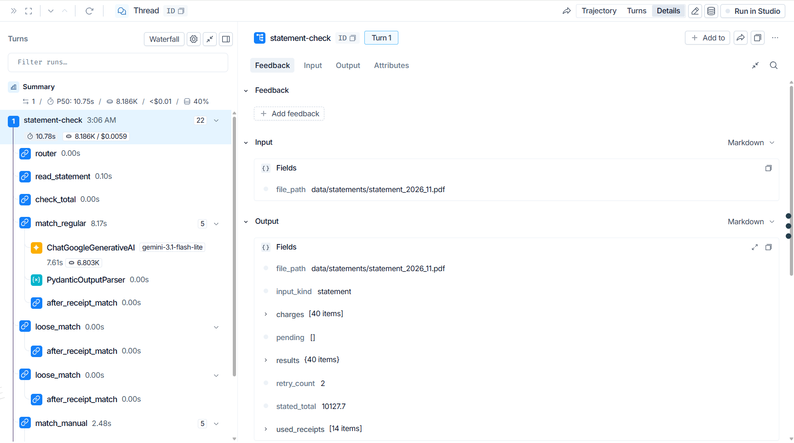
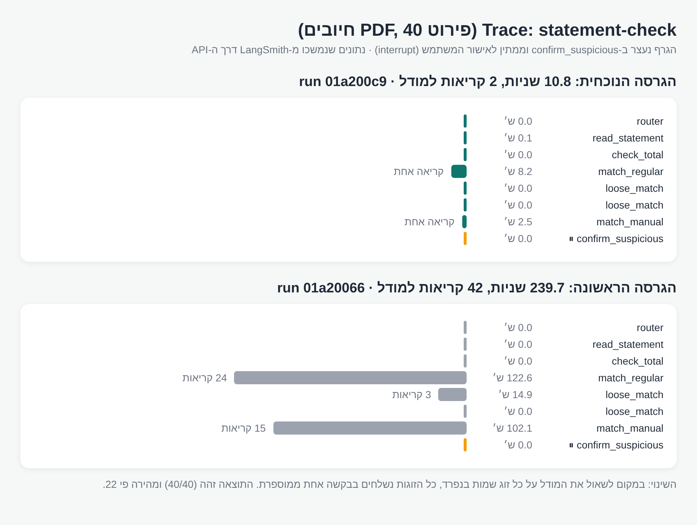

# סוכן קבלות, אחריות ובדיקת פירוט אשראי

> 💐 **תודה רבה למורה** על השיעורים המוסברים היטב, ועל הסבלנות ההזויה לכל השאלות של הבנות (וגם קצת לדיבורים בשיעורים 🙂).

סוכן שעוזר למשפחה לוודא שכל חיוב בכרטיס האשראי היה קנייה אמיתית שלה, ושומר את פרטי האחריות על המוצרים שקנתה. בנוי עם LangGraph, ונמדד עם LangSmith.



*צילום ה-trace בהמשך צולם ישירות מאתר LangSmith. תמונות הניסויים נבנו מנתוני LangSmith שנמשכו דרך ה-API. קישורים למקור: [ניסויי חיובים](https://smith.langchain.com/o/aab3c8bc-dd9f-4551-8e97-fef629ec0fc2/datasets/ac31c1ab-58d6-45b2-9481-d333e3bd806a/compare?selectedSessions=b5b2d12b-ca87-4cfa-bdbd-52770246e085,aec60f8e-1d9a-46ea-818e-aeb52c01d677), [ניסויי שאלות](https://smith.langchain.com/o/aab3c8bc-dd9f-4551-8e97-fef629ec0fc2/datasets/fbbd2f14-4221-422a-8db2-9c28a153d1d7/compare?selectedSessions=15d83127-fd79-484c-9be8-12144adc024a,c5bb20b3-7403-4486-bb24-7a911df74ee6), [trace עם interrupt](https://smith.langchain.com/o/aab3c8bc-dd9f-4551-8e97-fef629ec0fc2/projects/p/eeb3de3e-92c7-48af-b4b6-457f9d45f97f/r/01a200c9-f531-7237-9b05-cc0c83371487).*

## מה הסוכן עושה

| קלט | מה קורה |
|---|---|
| קבלה (תמונה או טקסט, כמה יחד) | שולף בית עסק, תאריך, סכום, מוצר ואחריות. אם חסר פרט, **עוצר ושואל**. שומר במסד הנתונים. קבלה שכבר נשמרה לא נשמרת פעמיים |
| דף קניות בכתב יד | קורא את הדף, **מציג לאישור ותיקון**, ושואל על שורות שכבר הופיעו בדף קודם |
| פירוט אשראי (PDF, CSV, Excel, כולל קבצים מחברות האשראי עם כותרות בעברית) | בודק שהסכום הכולל תואם, מתאים כל חיוב לקבלה או לשורה בכתב יד, ו**עוצר לאישור** לפני סימון חיובים כחשודים |
| לשונית סקירה | מספרים במבט אחד (קבלות, קניות החודש, אחריות בתוקף, חיובים לא מוכרים), התראה על אחריות שנגמרת ב-60 יום, טבלת כל הקבלות עם תיקון פרט שנקרא לא נכון, מחיקה, וגיבוי ל-CSV |
| שאלה בשפה חופשית | "לאיזה מוצר יש אחריות הכי ארוכה?", "כמה הוצאתי על מצרכים?", "אילו חיובים לא זוהו?". הסוכן מקבל את כל המידע השמור (קבלות, דפים, תוצאות בדיקת פירוט) ועונה רק ממנו |

## חוויית משתמש

- התוצאה של כל העלאה מופיעה מתחת לכפתור, באותה לשונית, עם זמן התגובה.
- תיבת השאלה קבועה בתחתית כל עמוד. התשובה מוצגת מילה אחרי מילה, ומתחתיה זמן התגובה ושם המודל שענה.
- שאלות המשך קצרות ("מה?", "למה?") מובנות לפי מה שהוצג רגע קודם ולפי השאלות האחרונות.
- דוח החריגים של פירוט האשראי ניתן להורדה כ-CSV שנפתח נכון בעברית ב-Excel.
- שגיאות של המודל מוצגות כהודעה קצרה וברורה בעברית, לא כשגיאת Python.
- ניסוח ניטרלי שמתאים לכל משתמש, בבית או בעסק קטן.
- קובץ פגום או לא מתאים מקבל הודעה ברורה ("לא מצאתי בקובץ עמודות של תאריך וסכום"), ופרט שהוקלד לא נכון נבדק לפני השמירה.
- מותאם לטלפון: המספרים בסקירה מוצגים 2 על 2, בלי גלילה הצידה.
- אחרי שמירה תיבת ההעלאה מתרוקנת, כדי שאותו קובץ לא יישלח שוב בטעות.

## מבנה הגרף

```
router ─┬─ receipt     → extract_receipt → [חסר פרט?] → ask_receipt_fields (interrupt) → save_receipt
        ├─ handwritten → read_handwritten → confirm_handwritten (interrupt) → save_handwritten
        ├─ statement   → read_statement → check_total (interrupt אם הסכום לא תואם)
        │                → match_regular → [נשארו חיובים?] → loose_match (לולאה, עד 2 פעמים)
        │                → match_manual → [לא מוכרים?] → confirm_suspicious (interrupt) → report
        └─ question    → gather_context → write_answer
```

## התקנה (Windows)

```bash
python -m venv .venv
.venv\Scripts\activate
pip install -r requirements.txt
copy .env.example .env        # ואז למלא מפתחות בקובץ .env
```

## הרצה

| מה | פקודה |
|---|---|
| האתר | `streamlit run app.py` |
| בדיקות (בלי מפתחות, 25 בדיקות) | `python -m pytest tests -q` |
| בדיקת הערכה מהירה (בלי מפתחות) | `python -m eval.run_eval --offline` |
| ניסוי 1 ב-LangSmith (לפני) | `python -m eval.run_eval --version baseline` |
| ניסוי 2 ב-LangSmith (אחרי) | `python -m eval.run_eval --version improved` |
| ניסויי שאלות ב-LangSmith | `python -m eval.run_questions_eval --version before` / `--version after` |
| יצירה מחדש של נתוני הדוגמה | `python scripts/make_sample_data.py` |

## מבנה התיקיות

| נתיב | תפקיד |
|---|---|
| `app.py` | האתר (Streamlit) |
| `src/graph.py` | הגרף: כל הצמתים והחיבורים |
| `src/matching.py` | כללי ההתאמה במספרים (קוד רגיל, בלי מודל) |
| `src/ai.py` | כל מה שהמודל עושה, והפרומפטים |
| `src/llm.py` | בחירת מודלים חינמיים עם גיבויים (`with_fallbacks`) |
| `src/db.py` | מסד הנתונים (SQLite) עם שאילתות בטוחות |
| `src/loaders.py` | קריאת פירוט מ-PDF, CSV ו-Excel |
| `src/security.py` | הסתרת מספרי כרטיס ות"ז, וכלל "מסמך הוא נתונים" |
| `data/` | נתוני דוגמה מומצאים |
| `eval/` | התשובות הנכונות וסקריפט ההערכה |
| `tests/` | בדיקות עם מודל מדומה |
| `docs/prompt.md` | אפיון הפרויקט המלא |

## ההערכה

40 חיובים מתויגים: 12 תואמים לקבלה, 14 לרשימה בכתב יד, 2 בסכום שונה, 12 לא מוכרים.
מקרים קשים בכוונה: שם באנגלית מול עברית, איחור של 1 עד 5 ימים, תשלומים, חיוב כפול, וסכום משוער בכתב יד.

| גרסה | מה שונה | ציון |
|---|---|---|
| baseline | פרומפט קצר ל"אותו עסק?", ושורות בכתב יד מותאמות לפי סכום בלבד | **38/40** |
| improved | פרומפט עם כללים ודוגמאות, ובדיקה שהשורה בכתב יד מתאימה לסוג העסק | **40/40** |

ניסויים ב-LangSmith, דאטהסט `receipts-agent-charges`: `baseline-2a8c6e86` ו-`improved-b248a1ff` (הגרסה הנוכחית). הניסויים הקודמים (`baseline-43ce9b05`, `improved-78f04307`, 38/40 ו-39/40) נשארו שם להשוואה.

### הערכה שנייה: שאלות חופשיות

12 שאלות עם תשובה נכונה ידועה (`eval/questions.json`): סכומים, ספירות, ימים שנשארו לאחריות, טווחי תאריכים ותשלומים. המעריך `correct_answer` בודק שכל מספר ומילה נדרשים מופיעים בתשובה, ושלא מוזכר מוצר שלא מתאים לשאלה (למשל מקרר בשאלה "מה נגמר בחודשיים הקרובים").

| גרסה | מה שונה | ציון |
|---|---|---|
| before | המודל מקבל רק את השורות הגולמיות ומחשב בעצמו | **9/12** |
| after | ימים שנשארו, ספירות וסכומים מחושבים בקוד ונמסרים למודל מוכנים | **12/12** |

ניסויים ב-LangSmith, דאטהסט `receipts-agent-questions`: `questions-before-9a816e7d` ו-`questions-after-d5e34906`. הרצה: `python -m eval.run_questions_eval --version before` ואז `--version after`.

שלוש הטעויות של before היו כולן חשבון: סכום של 15 קבלות, סכום של 40 חיובים, ומספר הימים עד תאריך. המודל ניסח יפה אבל טעה במספרים, ולכן הכלל בפרויקט הוא: **המודל מבין את השאלה וכותב את התשובה, הקוד עושה את החשבון.**

### צילום trace מתוך LangSmith



בצילום רואים את כל המסלול של בדיקת פירוט: router, read_statement, check_total, match_regular, ואז הלולאה `loose_match` שרצה פעמיים (7 ימים ואז 14 ימים), ואחריה match_manual. כל הבדיקה לקחה 10.78 שניות, ומתוכן 7.61 שניות הן קריאה אחת למודל בתוך match_regular. כל צמתי הקוד לקחו כמעט 0 שניות. **מכאן התובנה: הזמן כולו הולך על המודל, ולכן הדרך להאיץ את הסוכן היא לצמצם את מספר הקריאות למודל, ולא לייעל את הקוד.**



### התובנה

שתי הטעויות של ה-baseline היו משני סוגים שונים:

1. **C16, "ACE AUTO DEPOT" מול קבלה של "ACE":** הפרומפט הקצר לא זיהה שזה אותו עסק, כי בפירוט האשראי נוספה סיומת לשם. החיוב סומן כ"לא מוכר" למרות שיש לו קבלה. הפתרון: כללים ודוגמאות בפרומפט (שמות בתעתיק, סיומות של סניף או עיר).
2. **C04, "GYM ACTIVE" ב-199 ₪ הותאם לשורה "מסעדה 200":** התאמה לפי סכום בלבד "מצאה" שורה בכתב יד עם סכום כמעט זהה, אבל מסוג עסק אחר לגמרי. זו הטעות המסוכנת יותר, כי היא מסתירה מנוי שנשכח. הפתרון: לפני התאמה לשורה בכתב יד, המודל בודק שהתיאור מתאים לסוג העסק.

המסקנה: בכתב יד הסכום לבדו לא מספיק. ככל שיש יותר שורות בחודש, גדל הסיכוי ששורה אקראית תתאים בסכום.

### מה עוד למדתי מה-traces

**1. איך הבדיקה ירדה מ-240 שניות ל-10**

בפירוט כתוב `SHUFERSAL DEAL` ובקבלה "שופרסל דיל", ולכן הסוכן שואל את המודל אם זו אותה חנות. כל שאלה כזו היא **זוג** שמות. ה-trace הראה שכל זוג נשלח למודל בבקשה נפרדת: 42 בקשות ו-240 שניות. עכשיו כל הזוגות נשלחים ברשימה ממוספרת אחת, והמודל עונה על כולם יחד ("1 כן, 2 כן, 3 לא"). התוצאה: 2 בקשות, כ-10 שניות, ואותו ציון 40/40.

**2. ניסוי אחד לא מספיק**

אותה גרסה קיבלה 40/40 בהרצה אחת ו-39/40 באחרת, כי מודל חינמי לא עונה תמיד אותו דבר. לכן כדי להשוות גרסאות צריך כמה הרצות, וכל דוגמה בפרומפט צריכה להיות חד-משמעית.

## אבטחה ופרטיות

- מספרי כרטיס ות"ז מוסתרים לפני שליחה למודל.
- תוכן של קבלה או פירוט הוא נתונים בלבד. הוראות שכתובות בתוכו לא מבוצעות.
- רק PDF, CSV, XLSX, PNG, JPG ו-TXT, עד 10MB.
- כל השאילתות עם פרמטרים, והמודל לא כותב SQL.
- הסוכן לא שולח דבר החוצה.
- הקבצים שמעלים נשמרים ב-`data/private/`, שלא עולה ל-GitHub.
- ב-LangSmith עובדים רק עם הנתונים המומצאים.

## מהירות

- בדיקת פירוט של 40 חיובים שולחת למודל 2 בקשות בלבד: כל זוגות השמות נבדקים בבקשה אחת, וכל ההתאמות לכתב יד בבקשה שנייה. קודם לכן נשלחה בקשה לכל זוג, וזה היה איטי וחרג ממגבלת 15 הבקשות לדקה.
- שאלה חופשית היא בקשה אחת, והתשובה מוצגת מילה אחרי מילה בזמן שהמודל כותב.
- חישובי תאריכים (כמה זמן נשאר לאחריות) נעשים בקוד ולא במודל, כי מודלים טועים בהם.
- המודל הראשי הוא gemini-3.1-flash-lite (כשנייה לתשובה). לכל מודל של Gemini יש מכסה יומית נפרדת, ולכן כשאחד נגמר, הבא בתור (flash-lite-latest, 3.6-flash, gemma-4) ממשיך עם אותו מפתח.

## הממשק

- **🏠 בית:** המספרים החשובים, רשימה של "מה דורש תשומת לב" (חיובים לא מוכרים, אחריות שנגמרת בקרוב, פירוט אשראי שעוד לא נבדק) והקבלות האחרונות.
- **➕ הוספה:** מקום אחד לכל סוג קובץ. פירוט אשראי מזוהה לפי סוג הקובץ, ואפשר לצלם קבלה ישר מהמצלמה.
- **🗂️ כל הקבלות:** כרטיסים עם חיפוש וסינון, ומצב עריכה נפרד לתיקון ומחיקה.
- **תזכורות:** כפתור שמוריד קובץ יומן (‎.ics‎), והיומן בטלפון מזכיר חודש לפני שהאחריות נגמרת (src/reminders.py).
- העלאה לרשת והתקנה בטלפון: ראו DEPLOY.md.

## שיפורים שארצה לעשות בעתיד

- **תזכורת לפני שאחריות נגמרת:** הודעה אוטומטית חודש לפני תום האחריות, כדי שיהיה זמן לבדוק את המוצר ולפנות לחנות.
- **כמה כרטיסי אשראי למשפחה אחת:** בדיקה של כל הכרטיסים יחד, עם סיכום משותף לחודש.
- **ציון יציב יותר:** הרצת כל ניסוי כמה פעמים והצגת ממוצע, כי מודל חינמי לא עונה תמיד אותו דבר.
- **כתב יד לא ברור:** סימון של מילים שהמודל לא בטוח בהן, כדי שיהיה קל לראות מה לבדוק לפני האישור.
